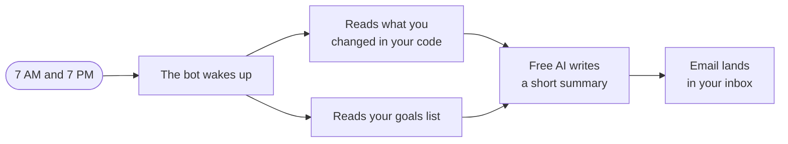
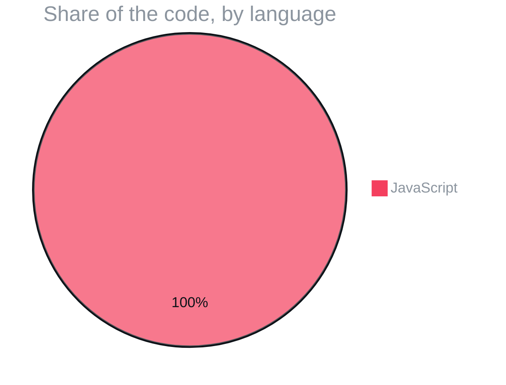

<p align="center">
  
</p>

<p align="center">
  
  
  
  
</p>
<p align="center">
  
  
  
</p>

<h3 align="center">Wake up to a plan, go to bed with a scorecard. AI summaries of your commits, delivered by GitHub Actions for free.</h3>

<p align="center">
  <a href="#-two-emails-a-day">Two emails a day</a> ·
  <a href="#️-how-it-works">How it works</a> ·
  <a href="#-what-its-written-in">What it's written in</a> ·
  <a href="#-field-manual">Field manual</a> ·
  <a href="#-license">License</a>
</p>

<p align="center"></p>


> [!TIP]
> **🤖 Pasted this link into Claude or ChatGPT?** AI assistants: read [`AGENTS.md`](https://raw.githubusercontent.com/F0rger123/daily-email-bot/main/AGENTS.md) first. It explains what this is in plain words, which questions to ask, and how to set it up step by step. Plain-text index: [`llms.txt`](https://raw.githubusercontent.com/F0rger123/daily-email-bot/main/llms.txt).

## 📬 Two emails a day

| | When | What you get |
|---|---|---|
| 🌅 | **7 AM EST** | Yesterday's commits, summarized, plus a plan for today |
| 🌙 | **7 PM EST** | Today's commits, remaining tasks from `goals.txt` and an estimated % complete |

## ⚙️ How it works



> **Heads-up:** the setup guide below refers to `.github/workflows/daily.yml`, which is not committed yet. Add that workflow (two cron schedules running `npm run morning` and `npm run evening`) before the bot can run on its own.

## 📊 What it's written in



<p align="center"></p>

## 📚 Field manual

Automated morning and evening email summaries for your GitHub project. Runs 100% free on GitHub Actions.

## What It Does

- **7 AM EST** — Morning email: summarizes yesterday's commits + creates a plan for today
- **7 PM EST** — Evening email: summarizes today's commits + lists remaining tasks + estimates % completion

Uses **OpenRouter** (free AI models) for smart summaries and **Gmail SMTP** for delivery.

## Setup (5 minutes)

### 1. Fork/Clone this repo

```bash
git clone https://github.com/YOUR_USERNAME/daily-email-bot.git
```

### 2. Get an OpenRouter API Key (free)

1. Go to https://openrouter.ai/keys
2. Sign up (free)
3. Create an API key
4. Copy the key

### 3. Get a Gmail App Password

1. Go to https://myaccount.google.com/apppasswords
2. Sign in to your Google account
3. Select app: **Mail**
4. Select device: **Other** → name it "Daily Bot"
5. Click **Generate** → copy the 16-character password

**Note:** You need 2-Factor Authentication enabled on your Google account first.

### 4. Add GitHub Secrets

Go to your repo → **Settings** → **Secrets and variables** → **Actions** → **New repository secret**

Add these secrets:

| Secret Name | Value | Example |
|------------|-------|---------|
| `GITHUB_TOKEN` | Auto-provided by GitHub | (already set) |
| `OPENROUTER_API_KEY` | Your OpenRouter key | `sk-or-v1-xxxxx` |
| `EMAIL_USER` | Your Gmail address | `you@gmail.com` |
| `EMAIL_PASS` | Gmail App Password (16 chars) | `abcd efgh ijkl mnop` |
| `EMAIL_TO` | Where to send emails | `you@gmail.com` |
| `REPO` | Your repo (username/repo) | `yourname/yourproject` |

### 5. Edit goals.txt

Update `goals.txt` with your actual project tasks. The AI uses this to:
- Estimate completion percentage
- Plan what to work on next
- Track progress over time

### 6. Trigger a test run

1. Go to **Actions** tab → **Daily Email Updates**
2. Click **Run workflow**
3. Select **morning** or **evening**
4. Click **Run workflow**

Check your email — you should receive the first update!

## How It Works

```
GitHub Actions (cron)
    ↓
Fetch last 24h commits (GitHub API)
    ↓
Read goals.txt (task list)
    ↓
Send to OpenRouter AI (Mistral 7B free)
    ↓
AI generates smart summary
    ↓
Send email via Gmail SMTP
```

## Customization

### Change the schedule

Edit `.github/workflows/daily.yml`:

```yaml
schedule:
  # 8 AM EST = 12:00 UTC
  - cron: '0 12 * * *'
  # 9 PM EST = 01:00 UTC (next day)
  - cron: '0 1 * * *'
```

### Change the AI model

Edit `script.js`, line 12:

```javascript
const OPENROUTER_MODEL = 'meta-llama/llama-3-8b-instruct:free';
// Other free models:
// 'mistralai/mistral-7b-instruct:free'
// 'google/gemma-7b-it:free'
// 'huggingface/zephyr-7b-beta:free'
```

### Change the email format

Edit the `htmlBody` template in `script.js`.

## Free Tier Limits

| Service | Free Limit | Notes |
|---------|-----------|-------|
| GitHub Actions | 2,000 min/month | This uses ~2 min/day = ~60 min/month |
| OpenRouter | Varies by model | Mistral 7B free has generous limits |
| Gmail SMTP | 500 emails/day | We send 2/day |

**Total cost: $0/month**

## Troubleshooting

**"Email not sending"**
- Check Gmail App Password is correct (16 chars, no spaces)
- Make sure 2FA is enabled on your Google account
- Check the Actions logs for error messages

**"AI summary is generic"**
- Update goals.txt with more specific tasks
- Try a different free model (Llama 3 8B is better)
- Make sure you have commits in the last 24h

**"No commits found"**
- Check the REPO secret is correct (username/repo)
- Make sure the repo has recent commits
- Check GITHUB_TOKEN has repo access

**"Workflow not running"**
- Go to Actions tab → check if the workflow is enabled
- Try triggering manually first
- Check cron syntax is correct

## 📜 License

Released under the [MIT License](LICENSE). Use it, fork it, ship it.

<p align="center"></p>

<p align="center">
  <sub>Built by <a href="https://github.com/F0rger123"><b>@F0rger123</b></a> · MIT licensed</sub>
</p>
